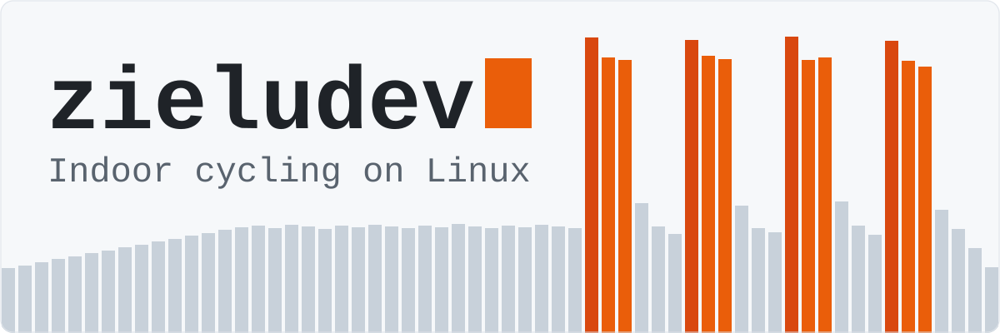

  <picture>
    <source media="(prefers-color-scheme: dark)" srcset="assets/banner-dark.svg">
    <source media="(prefers-color-scheme: light)" srcset="assets/banner-light.svg">
    
  </picture>

I build tools that make indoor cycling work on Linux. In practice that means Bluetooth LE, virtual
machines and containers, and a lot of shell and Python. I test what I publish and write down how it
works.

- **[rouvy-linux](https://github.com/zieludev/rouvy-linux)**: an unofficial launcher for the ROUVY
  indoor cycling app on Linux. One command boots a Windows VM, lends it your Bluetooth adapter and
  opens the app.
